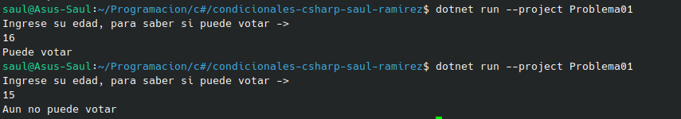

# Problema 01 - Registro electoral

**Estructura elegida:** Elegi la estructura de operador ternario.

**Justificación:** Me parecio que esta es la mejor a la hora de asignar unicamente  dos valores, uno en caso de ser verdadero y otro en caso de ser falso.

**Evidencia:**

