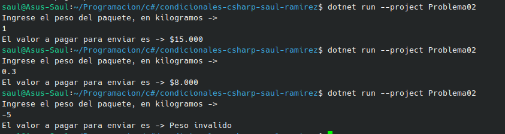

# Problema 02 - Tarifa de envío por peso

**Estructura elegida:** Elegi la estructura de Switch expressions.

**Justificación:** Me parecio que esta es la mejor, porque como debo asignar un valor dependiendo del peso de cada paquete, me parecio que esta estructura es la manera mas corta posible y mas eficaz.

**Evidencia:**

