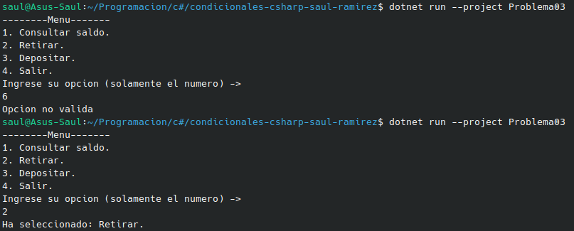

# Problema 03 - Tarifa de envío por peso

**Estructura elegida:** Elegi la estructura de Switch expressions.

**Justificación:** Por lo corta que suele ser la estructura a la hora de asignar valores y lo limpia que se ve en el codigo sin necesidad de tantas lineas como en el Switch normal o un if else.

**Evidencia:**

