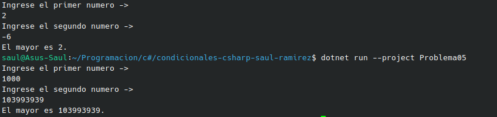

#  Problema 5 - El mayor de dos números

**Estructura elegida:** Elegi la estructura de operador ternario.

**Justificación:** La escogo ya que en el ejercicio me pide decidir cual numero es mayor unicamente en una linea, y esta es la unica capaz de hacerlo.

**Evidencia:**

