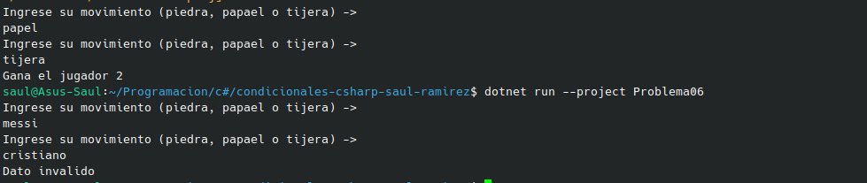

#  Problema 6 - Piedra, papel o tijera

**Estructura elegida:** Elegi la estructura de if / else.

**Justificación:** La escogi porque necesitaba validar varios casos, y diferentes respuestas.

**Evidencia:**

