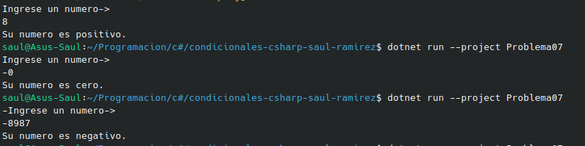

#  Problema 7 - Signo de un número

**Estructura elegida:** Elegi la estructura operador ternario.

**Justificación:** Solamente era asignar a una sola variable un valor que variaba de lo que pone el usuario, por ende me parecio el mas sencillo de usar.

**Evidencia:**

