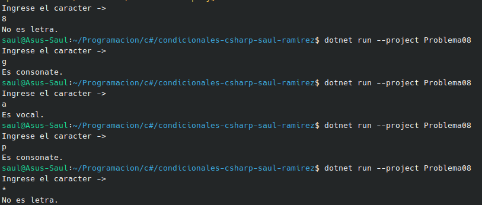

#  Problema 8 - Vocal o consonante.

**Estructura elegida:** Elegi la estructura de switch expressions.

**Justificación:** Habia muchos caracteres por el caso de consonante, y se pudo haber realizo con un .isLetter; pero decidi mantener solo con un switch  expressions, porque el profesor no nos ha enseñado eso.

**Evidencia:**

