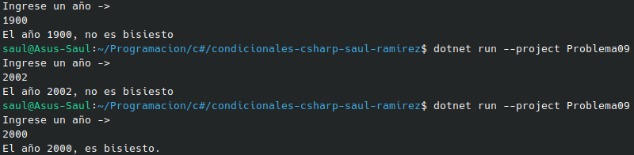

#  Problema 9 - Año bisiesto

**Estructura elegida:** Elegi la estructura de operador ternario.

**Justificación:** Por su simplicidad ya que solamente se basa en definir una variable dependiendo del dato entrante.

**Evidencia:**

