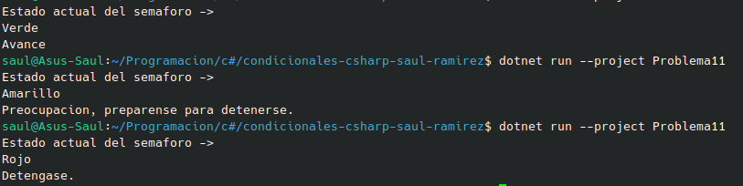

#  Problema 11 - Semáforo inteligente

**Estructura elegida:** Elegi la estructura de Switch expressions.

**Justificación:** Era una simple asignacion de strigs, y como eran varias asignaciones, y este es el modelo mas sencillo.

**Evidencia:**

