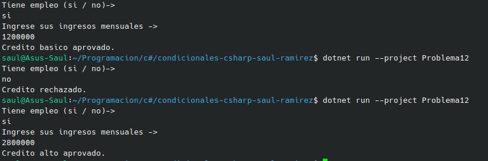

#  Problema 12 - Aprobación de crédito

**Estructura elegida:** Elegi la estructura de if / else.

**Justificación:** Decidi esta estructura ya que para poder seguir con el siguiente paso, necesito esperar cual es la respuesta y dependiendo de esta cambia la respuesta al usuario.

**Evidencia:**

