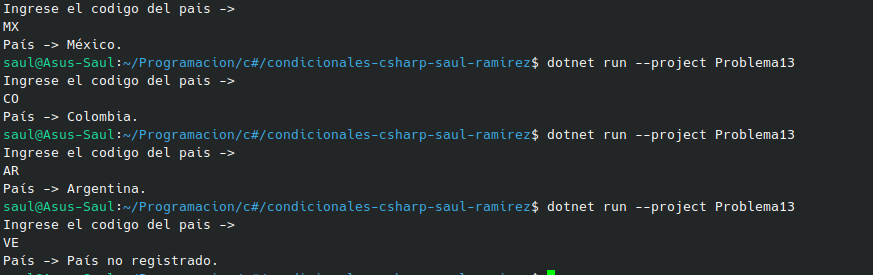

#  Problema 13 - Códigos de país

**Estructura elegida:** Elegi la estructura de Switch expressions.

**Justificación:** Esta estructura a mi me parece la correcta ya que solamente es una asignacion de strigs depediendo del dato que ingrese el usuario.

**Evidencia:**

