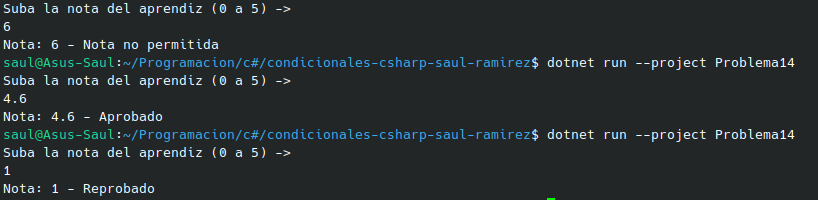

#  Problema 14 - Estado del aprendiz

**Estructura elegida:** Elegi la estructura de Operador Ternario.

**Justificación:** Al ser una sola variable la que cambia, por eso se eligio esta y tambien porque asi se solicitado en el enunciado.

**Evidencia:**

