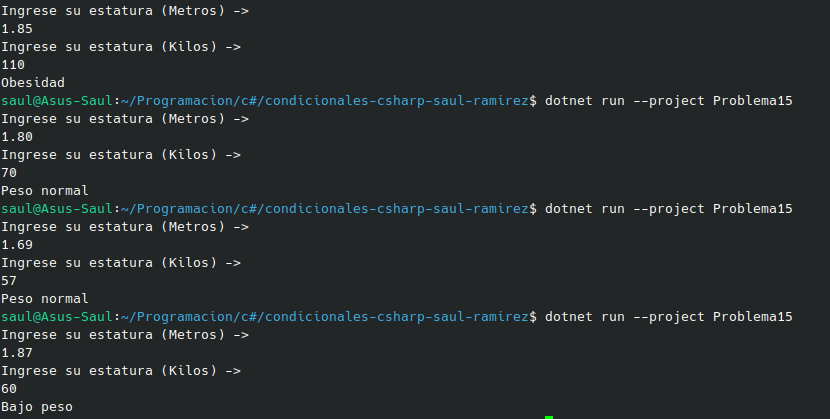

#   Problema 15 - Índice de masa corporal

**Estructura elegida:** Elegi la estructura de Operador Ternario.

**Justificación:** Al ser una sola variable la que cambia, y por eficacia se decidio por esta.

**Evidencia:**

