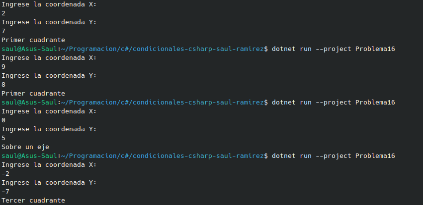

#   Problema 16 - Ubicación de un dron

**Estructura elegida:** Elegi la estructura de Switch expressions.

**Justificación:** Al ser una variable que cambia dependiendo de dos valores y este devuleve un string se escogio esta estructura por la sencilez con la que se ve.

**Evidencia:**

