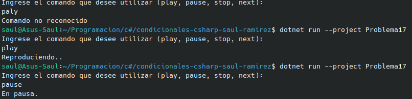

#    Problema 10 - Analizador de datos recibidos

**Estructura elegida:** Elegi la estructura de switch.

**Justificación:** Permite evaluar dinámicamente el tipo de dato subyacente guardado dentro de la variable object y, de forma simultánea, extraer ese valor a una nueva variable fuertemente tipada (como texto, entero o booleano). Esto elimina la necesidad de realizar múltiples comprobaciones secuenciales con if y conversiones manuales (casting), haciendo que el código sea mucho más limpio, directo y seguro frente a errores de tipo.

**Evidencia:**

