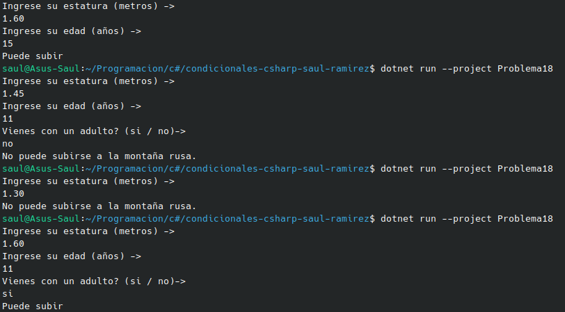

#    Problema 18 - Montaña rusa

**Estructura elegida:** Elegi la estructura de if / else.

**Justificación:** Como en este problema tenemos que cumplir unas condiciones, o si no nos lleva a otros resultados; creeria que esta estructura es la mejor.

**Evidencia:**

