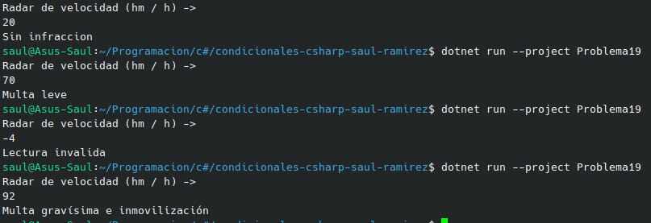

#    Problema 19 - Radar de velocidad

**Estructura elegida:** Elegi la estructura de Switch expressions.

**Justificación:** Solo cambia de strigs una varaible dependiendo de la velocidad, por eso y para ver el codigo mas limpio escogi este metodo.

**Evidencia:**

