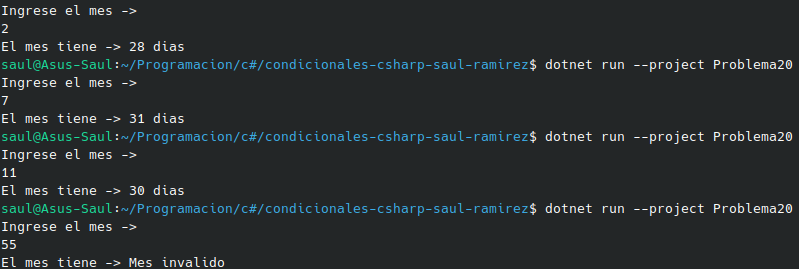

#    Problema 20 - Días de cada mes

**Estructura elegida:** Elegi la estructura de Switch expressions.

**Justificación:** Como son varios datos agrupados los que poseen los cambios de string de esta manera es la mas ordenada.

**Evidencia:**

