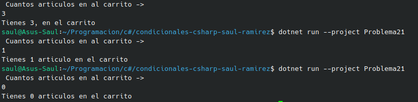

#    Problema 21 - Carrito de compras

**Estructura elegida:** Elegi la estructura de operador ternario.

**Justificación:** Es la manera mas sencilla de hacerlo, y aparte me lo pide asi en el problema.

**Evidencia:**

