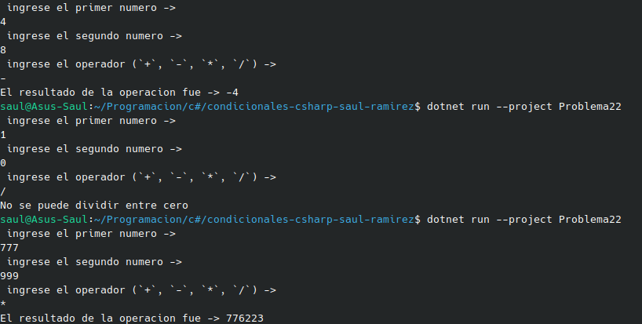

#    Problema 22 - Calculadora básica

**Estructura elegida:** Elegi la estructura de if / else.

**Justificación:** Escogi esta estructura porque para poder llegar al resultado se necesita una secuencia de pasos o mejor dicho un filtro para saber cual operacion y si es posible.

**Evidencia:**

