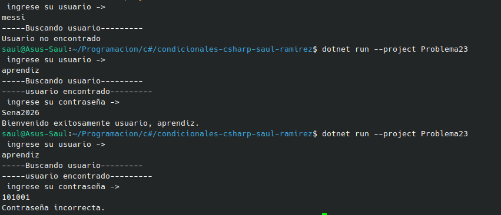

#     Problema 23 - Inicio de sesión

**Estructura elegida:** Elegi la estructura de if / else.

**Justificación:** Escogi esta estructura porque para poder llegar al resultado se necesita una secuencia de pasos o mejor dicho un filtro para saber si los datos son los mismos que los guardados.

**Evidencia:**

