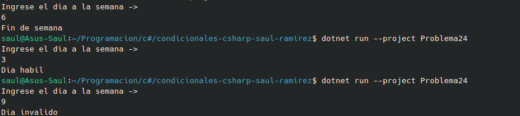

#     Problema 24 - ¿Día hábil?

**Estructura elegida:** Elegi la estructura de operador ternario.

**Justificación:** Escogi esta estructura, por su simmplicidad y al tan solo necesitar un cambio de string dependiendo de una variable, asi es mas sencillo.

**Evidencia:**

