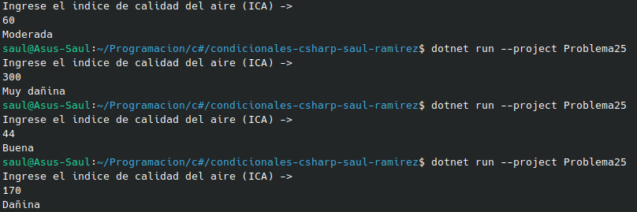

#     Problema 25 - Calidad del aire

**Estructura elegida:** Elegi la estructura de Switch expressions.

**Justificación:** Escogi esta estructura, porque necesitaba teenr varios casos para asignar dependiendo del ICA.

**Evidencia:**

