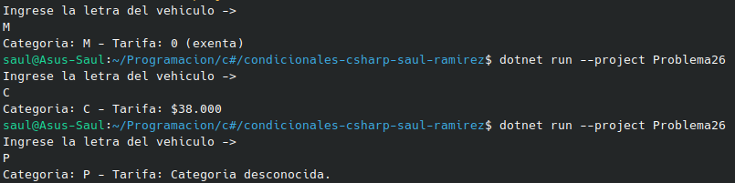

#     Problema 26 - Peaje

**Estructura elegida:** Elegi la estructura de Switch expressions.

**Justificación:** Escogi esta estructura, porque necesitaba teenr varios casos para asignar dependiendo del vehiculo.

**Evidencia:**

