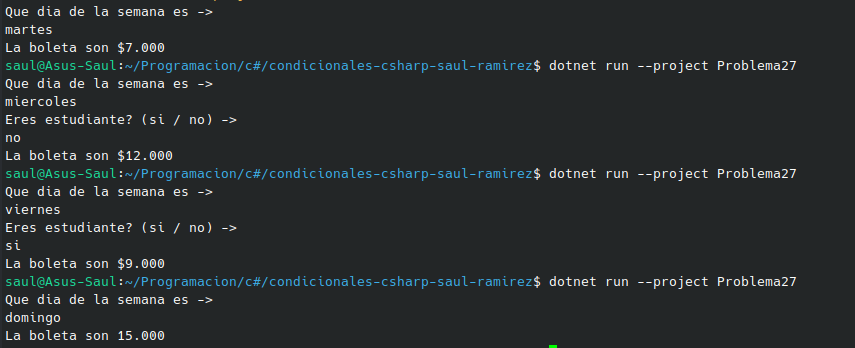

#     Problema 27 - Taquilla de cine

**Estructura elegida:** Elegi la estructura de if / else.

**Justificación:** Como este es un problema que la respuesta varia dependiendo de entrada del usuario, esta estructura maneja esas entradas o salidas de verdadero o falso.

**Evidencia:**

