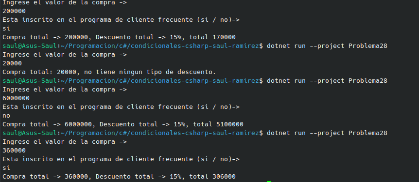

#     Problema 28 - Descuento por compra

**Estructura elegida:** Elegi la estructura de if / else.

**Justificación:** Porque, tenia que depender de varias cosas para poder obtener el resultado final, y de varios limitantes.

**Evidencia:**

