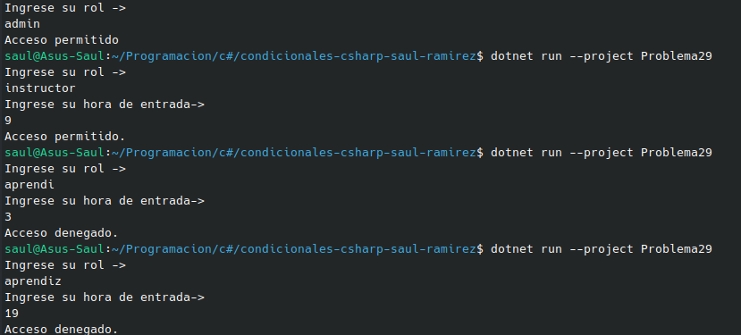

#     Problema 29 - Control de acceso a la sede

**Estructura elegida:** Elegi la estructura de if / else.

**Justificación:** Recibia varios datos, y dependia totalmente del tipo de dato que ingresaba el usuario, y dependiendo de esto totalmete para la toma de decisiones.

**Evidencia:**

