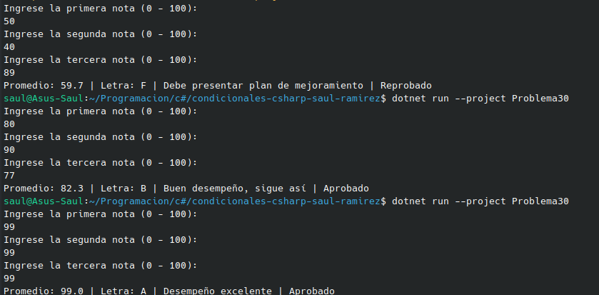

#     Problema 30 - Boletín de calificaciones (integrador)

**Estructura elegida:** Elegi la estructura de Integración (if, switch).

**Justificación:** Separa el cálculo matemático inicial, la clasificación central por rangos, y las excepciones aditivas (mención de honor).

**Evidencia:**

